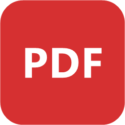
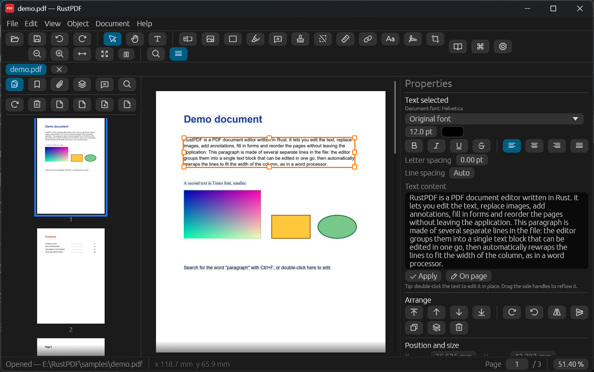
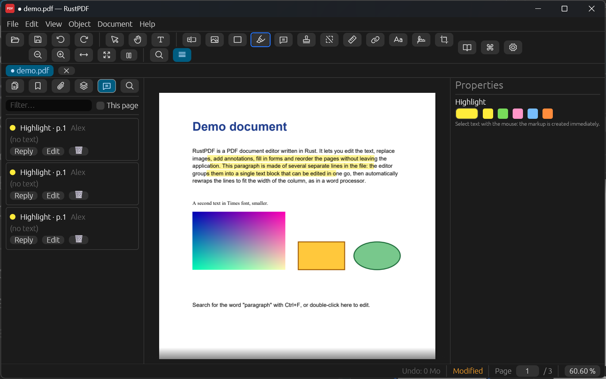
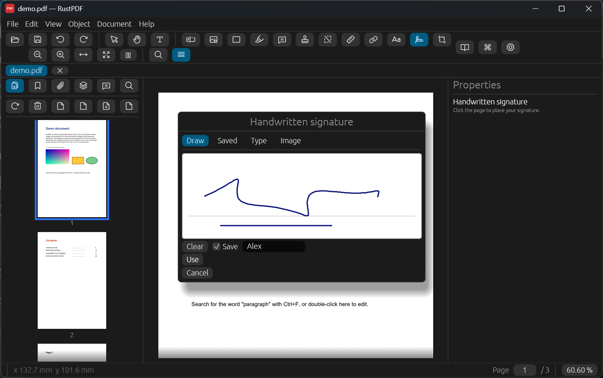
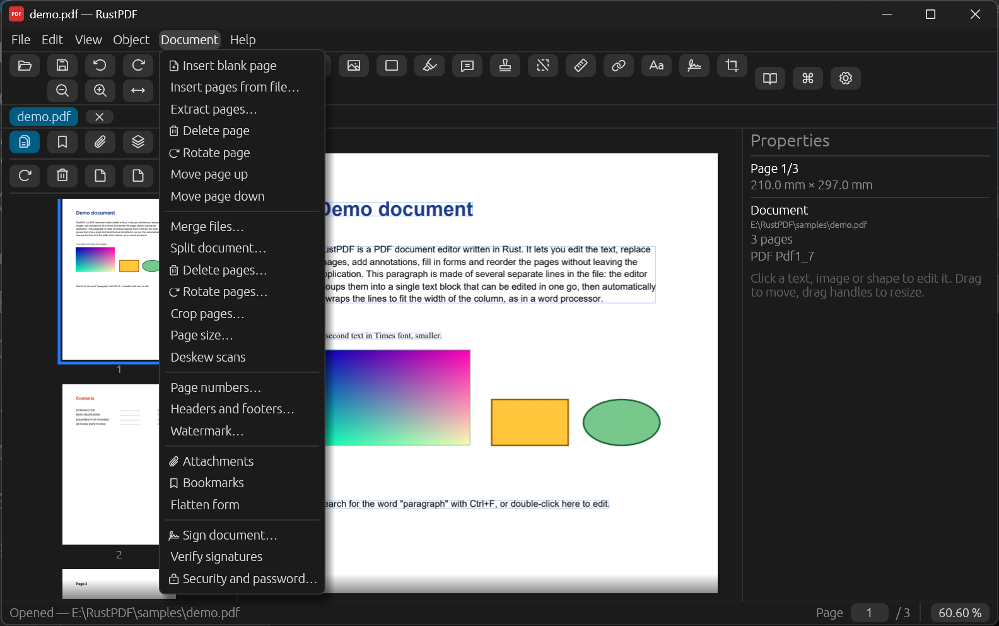
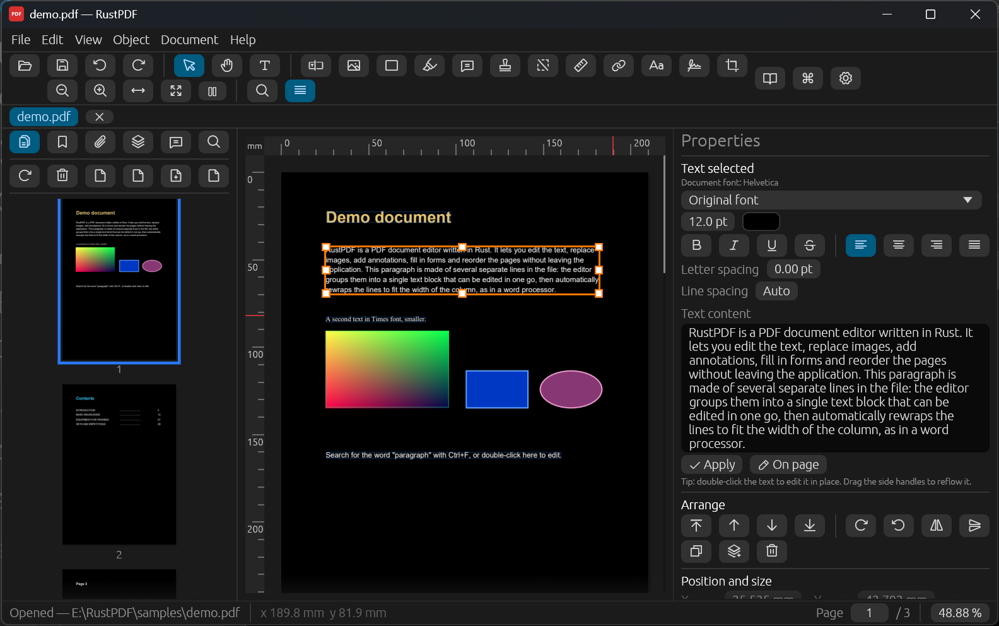
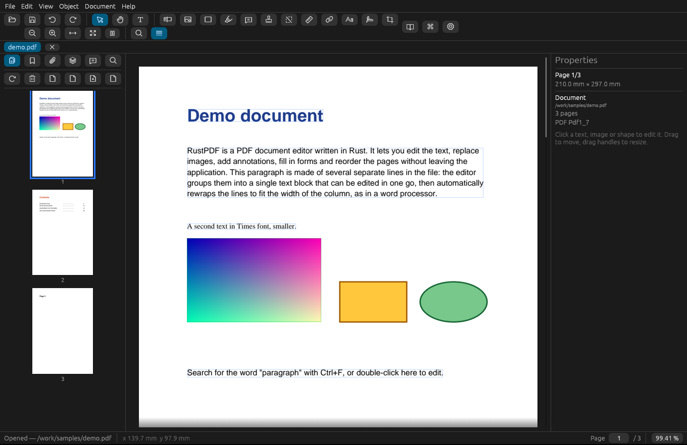

<div align="center">



# RustPDF

**A fast, native PDF editor written in Rust.**
Edit text and images right on the page, annotate, fill and create forms, sign, redact, reorganise pages — no browser, no subscription, no account.

[](https://github.com/myalban/rustpdf/actions/workflows/ci.yml)
[](LICENSE)




</div>

---

## Why RustPDF?

Most free PDF tools let you *read* and *annotate*. Few let you actually **change the document**. RustPDF aims at the everyday
things people reach for Acrobat Pro for, in a single small native app:

- ✏️ **Edit the text where it is.** Click a paragraph, type, and it reflows. Change font, size, colour, alignment, spacing; replace a font across the whole document.
- 🖼️ **Move, resize, replace and export images and shapes.** Multi-selection, groups, alignment, rotation, z-order, crop and adjust images, paste from the clipboard.
- 🖍️ **Annotate** with highlights, notes, stamps, and a comments panel with replies.
- 🔒 **Redact for real.** Redactions remove the text and pixels underneath, they do not just draw a black box.
- 📝 **Forms.** Fill them, create new fields (text, checkbox, radio, dropdown), tab between fields, flatten.
- ✍️ **Sign.** Draw, type or import a handwritten signature, or apply a real **PKCS#7 digital signature** (your `.pfx` or a self-signed certificate) and verify existing ones.
- 📄 **Organise pages.** Drag and drop thumbnails; insert, extract, split, merge, crop, resize, rotate, number, add headers/footers and watermarks, deskew scans.
- 🔐 **Protect.** AES-256 encryption with permissions, metadata cleaning.
- 🌍 **Speaks your language.** English, French, Spanish, German, Italian, Portuguese and Russian; it starts in the language of your computer.
- ⚡ **Quick.** Tiled rendering with a cache, an instant-undo snapshot prepared while you are idle, 20 MB documents are no problem.

<table>
  <tr>
    <td width="50%"><br><sub><b>Annotate</b> — highlights, notes and a comments panel with replies.</sub></td>
    <td width="50%"><br><sub><b>Sign</b> — draw, type or import a signature; real digital signatures too.</sub></td>
  </tr>
  <tr>
    <td width="50%"><br><sub><b>Pages & documents</b> — insert, extract, split, merge, crop, number, watermark…</sub></td>
    <td width="50%"><br><sub><b>Comfortable</b> — night mode, rulers in mm/cm/in/pt, a reading mode without frames.</sub></td>
  </tr>
</table>

## Install

### Download a build
Grab the archive for your system from the [**Releases**](https://github.com/myalban/rustpdf/releases) page.

| System | File | How |
|--------|------|-----|
| Windows 10/11 | `RustPDF-Setup-x.y.z.exe` or `RustPDF-portable.zip` | Run the installer, or unzip anywhere and start `rustpdf.exe`. |
| Linux (x86-64, arm64) | `rustpdf-linux-<arch>.tar.gz` | Unpack, then `./install.sh` (installs for your user in `~/.local`). |
| macOS (Intel, Apple silicon) | `RustPDF-macos-<arch>.dmg` | Drag `RustPDF.app` to Applications. First launch: right-click → Open (the app is not notarized). |

### Or build it yourself
You need a recent stable [Rust toolchain](https://rustup.rs) (edition 2024) and the PDFium library, which a helper script downloads for you.

**Windows**
```powershell
git clone https://github.com/myalban/rustpdf.git
cd rustpdf
scripts\fetch-pdfium.ps1            # downloads pdfium.dll next to Cargo.toml
cargo run --release -- samples\demo.pdf
```

**Linux** (Debian/Ubuntu names; use your distribution's equivalents)
```sh
sudo apt install build-essential pkg-config curl libgtk-3-dev libxkbcommon-dev libwayland-dev \
                 libx11-dev libxcb1-dev libxcursor-dev libxi-dev libxrandr-dev libgl1-mesa-dev
git clone https://github.com/myalban/rustpdf.git
cd rustpdf
sh scripts/fetch-pdfium.sh          # downloads libpdfium.so next to Cargo.toml
cargo run --release -- samples/demo.pdf
```
Fedora: `sudo dnf install gtk3-devel libxkbcommon-devel wayland-devel libX11-devel mesa-libGL-devel pkgconf-pkg-config`.

**macOS**
```sh
xcode-select --install              # compiler and system tools
git clone https://github.com/myalban/rustpdf.git
cd rustpdf
sh scripts/fetch-pdfium.sh          # downloads libpdfium.dylib next to Cargo.toml
cargo run --release -- samples/demo.pdf
```

The PDFium library is looked up next to the executable, then in the current folder, then in the system library path.
`scripts/fetch-pdfium.*` takes the prebuilt binaries from [bblanchon/pdfium-binaries](https://github.com/bblanchon/pdfium-binaries)
(set `PDFIUM_VERSION=chromium/XXXX` to pick another build).

### Make your own installer
```
installer\build-portable.ps1        # Windows: dist\RustPDF-portable.zip
iscc installer\rustpdf.iss          # Windows: dist\RustPDF-Setup-x.y.z.exe (needs Inno Setup 6)
sh installer/build-linux.sh         # Linux:   dist/rustpdf-linux-<arch>.tar.gz
sh installer/build-macos.sh         # macOS:   dist/RustPDF-macos-<arch>.dmg
```
Pushing a tag like `v0.3.0` makes GitHub Actions build all of them and attach them to a release (`.github/workflows/release.yml`).

## Using it

| Do this | Shortcut |
|---------|----------|
| Open / Save / Save as | `Ctrl+O` / `Ctrl+S` / `Ctrl+Shift+S` (`Cmd` on macOS) |
| Select · Hand · Text · Rectangle · Ellipse · Line | `V` · `H` · `T` · `R` · `E` · `L` |
| Find / Find and replace | `Ctrl+F` / `Ctrl+H` |
| Zoom | `Ctrl` + mouse wheel (centred on the cursor), `Ctrl+=` / `Ctrl+-` |
| Fit width / fit page / 100 % | `Ctrl+2` / `Ctrl+0` / `Ctrl+1` |
| Duplicate · Group · Ungroup | `Ctrl+D` · `Ctrl+G` · `Ctrl+Shift+G` |
| Keep proportions while resizing | hold `Ctrl` while dragging a handle |
| Show path points of a shape | hold `Alt` |
| Edit text in place | double-click it |
| Next field in a form | `Tab` / `Shift+Tab` |
| Reading mode (no frames) | `F9` |
| Command palette (every command, searchable) | `Ctrl+Shift+P` |
| Presentation mode · full screen | `Ctrl+L` · `F11` |

Everything is also in the menus, and the status bar shows the position of the pointer in your preferred unit.

## Project status

RustPDF is young and moving fast. An honest picture:

| | Windows | Linux | macOS |
|-|:-:|:-:|:-:|
| Builds and passes the test suite | ✅ | ✅ (tested in a Debian container) | ⚠️ not tested yet — CI is configured, please report |
| Launches and renders | ✅ | ✅ (X11, software rendering, screenshot below) | ⚠️ not yet |
| Used day to day | ✅ | ⚠️ not on a real desktop yet | ⚠️ not yet |
| Packaging | installer + zip | tar.gz + installer script | `.app` in a `.dmg` |

<details>
<summary>RustPDF running on Linux (Debian, X11)</summary>



</details>

Known limitations:
- No background rendering threads (PDFium is not thread-safe): rendering is incremental with a per-frame time budget.
- Undo keeps full-document snapshots (the memory cap is configurable).
- Digital signatures are RSA only and the certificate chain is not validated against a trust store.
- Text in subset fonts is replaced by a system font when glyphs are missing.
- macOS: opening a file through Finder's "Open with" is not wired up yet; use *File → Open* or drop the file on the window.
- Translations were written without a native review. Corrections are very welcome.

## How it works

RustPDF is built from three layers:
- **UI** — [egui / eframe](https://github.com/emilk/egui): menus, a tiled page view with a texture cache, panels and dialogs.
- **Rendering and object editing** — [PDFium](https://pdfium.googlesource.com/pdfium/) through [pdfium-render](https://github.com/ajrcarey/pdfium-render): page objects (text, images, paths) are read, moved and rebuilt in place.
- **File-level work** — [lopdf](https://github.com/J-F-Liu/lopdf) and RustCrypto: annotations with appearance streams, form fields, page structure, encryption, signatures.

A small engine groups PDF text fragments (often one object per word) back into lines and paragraphs so you can edit them like normal text.
See [CONTRIBUTING.md](CONTRIBUTING.md) for a map of the source.

## Contribute 💛

There are plenty of ways to help, and you do not need to be a PDF expert:

- **Try it on your own documents** and open an issue when something breaks — real-world PDFs are the best test suite.
- **Translate or review a language** — it is a single file of key/value pairs (`src/i18n_xx.rs`).
- **Test on Linux and macOS** and tell us what is off.
- **Pick an issue** labelled *good first issue*, or an item from the wishlist below.
- Improve the docs, the demo document or these screenshots.

Read [CONTRIBUTING.md](CONTRIBUTING.md), then open a pull request — small ones are great.

**Wishlist:** OCR, comparing two documents, PDF/A export, more languages (including right-to-left and CJK fonts), ECDSA signatures and trust-store validation, a proper macOS "Open with", Flatpak/AppImage packaging.

## License

Created by [Alban DOUSSAU de GUYONNET](https://github.com/myalban). MIT, see [LICENSE](LICENSE). PDFium and the libraries it bundles have their own licenses, see [`licenses/`](licenses/).
